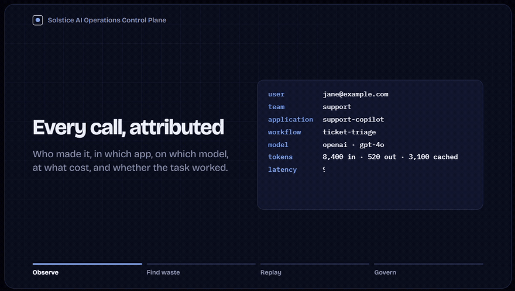
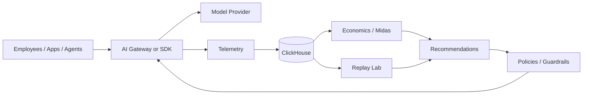

# Solstice AI Operations Control Plane

**See where AI is being used, what it costs, and whether a cheaper or safer setup will work before you enforce it.**

## Watch the demo

[](https://github.com/solsticeaistudio/ai-operations-control-plane/raw/refs/heads/main/demo/ai-operations-demo.mp4)

**[▶ Watch the full 1-minute demo](https://github.com/solsticeaistudio/ai-operations-control-plane/raw/refs/heads/main/demo/ai-operations-demo.mp4)**

---

Companies are adopting AI faster than most IT and security teams can govern it. Different teams use different models, providers, copilots, and agents. Costs are scattered. Usage is hard to attribute. And once leadership asks, “Who is using AI, how are they using it, and what guardrails should we put around it?”, the answer is often incomplete.

This project is a working prototype for that problem.

It collects AI usage telemetry, ties it back to the people and workflows creating it, looks for waste, replays captured workflows against alternative models, and turns validated findings into guardrails.

The basic idea is simple:

> **Observe first. Understand the behavior. Test the alternative. Then govern it.**

---

## The problem

Most organizations do not have one AI system. They have many.

A support team may use one model. Engineering may use another. A vendor product may call a third provider behind the scenes. Internal agents may retry calls, send oversized context, or use premium models for work a smaller model could handle just as well.

That creates a few practical problems:

- **You cannot manage spend if you cannot attribute it.** A monthly provider bill does not tell you which team, app, or workflow caused it.
- **Token counts alone do not tell you whether the spend was useful.** A cheap request that fails three times can cost more than one expensive request that succeeds.
- **Switching to a cheaper model without testing it is risky.** Cost savings are not savings if quality drops or humans have to redo the work.
- **Governance without telemetry turns into blanket rules.** Blanket rules are easy to write and easy for users to hate.
- **AI changes too quickly to hard-wire the company to one provider or model.** The surrounding controls need to stay stable even when the model changes.

The goal of this project is to give an AI operations team enough visibility and evidence to make better decisions.

---

## What the control plane does

### 1. Shows who is using AI

Every AI event can be attributed to a:

- user
- team
- application
- workflow
- agent
- provider
- model

That makes questions like these answerable:

- Which teams are driving AI spend?
- Which workflows use premium models the most?
- Which applications have unusually high token usage?
- Which users or agents are hitting policy limits?

### 2. Shows how AI is being used

The telemetry layer records operational details such as:

- input and output tokens
- cached tokens
- estimated cost
- latency
- retries
- tool calls
- data classification
- task success
- policy decisions

The purpose is not just to build another dashboard. It is to establish enough context to understand **why** cost or risk changed.

### 3. Finds likely waste

The economics layer looks for patterns such as:

- premium models being used for simple work
- large prompts with little benefit
- poor cache usage
- excessive retries
- expensive workflows with weak outcomes

Recommendations stay separate from enforcement. The system can say what it *would* change before it is allowed to change production behavior.

### 4. Replays a workflow before changing it

This is the part that makes the project more than a cost dashboard.

A workflow can be captured and replayed against other model choices. The same workload is held as constant as possible, and the candidates are compared on:

- cost
- latency
- task success
- quality score

That lets you ask a much more useful question than “Which model is cheaper?”

You can ask:

> **“Would this actual workflow still work if we moved it to a cheaper model?”**

### 5. Turns proven findings into guardrails

Policies can run in three modes:

- **Observe** — record what is happening.
- **Shadow** — record what the policy *would* have changed, without changing live behavior.
- **Enforce** — apply the validated policy.

Current guardrails include:

- approved and blocked providers
- token/context ceilings
- retry limits
- tool-call limits
- data-classification restrictions
- low-complexity model routing
- team/application/workflow budgets
- budget warnings, downgrades, and hard limits

The intended rollout pattern is:

> **Observe → Shadow → Enforce**

---

## A simple example

Imagine an internal support workflow is using a premium model for every ticket.

The control plane shows:

```text
Support ticket triage
---------------------
Calls this month:          42,000
Current model:             premium-model
Monthly AI spend:          $8,400
Cost / successful task:    $0.22
```

The economics engine flags it as a possible optimization target.

Instead of immediately changing the model, the replay layer tests the same captured workflow against a standard model:

```text
Current model
Cost / workflow:           $0.118
Quality:                    97.8%

Candidate model
Cost / workflow:           $0.052
Quality:                    97.1%
```

The candidate is substantially cheaper with very little quality loss.

The system can now recommend a **shadow routing policy** instead of making an unproven production change.

That is the core product loop:

> **Find the expensive behavior → test an alternative → prove it → turn it into policy.**

---

## Why “cost per successful task” matters

Provider pricing is useful, but it is not enough.

A smaller model can be cheaper per token and still be more expensive operationally if it causes more retries, longer conversations, or manual correction.

For that reason, this project treats **cost per successful task** as a first-class metric.

That shifts the goal from:

> “Use the cheapest model.”

To:

> **“Use the least expensive configuration that reliably gets the job done.”**

---

## How it works



The product can be used in two ways:

**Gateway mode** routes model requests through the control plane so policy can be evaluated before execution.

**Telemetry-only mode** lets an existing application keep its current model path and simply emit usage events through the Python SDK.

---

## What is real in this prototype

This repository is not a set of mock screenshots. The following pieces are implemented and runnable:

| Capability | Status |
| --- | --- |
| AI telemetry ingestion | Working |
| Attribution by user/team/app/workflow/model | Working |
| Cost and token analytics | Working |
| ClickHouse persistence | Implemented |
| SQLite local fallback | Working |
| Budget tracking | Working |
| Policy evaluation | Working |
| Observe / shadow / enforce modes | Working |
| Model routing guardrails | Working |
| Replay experiments | Working |
| Cost/quality comparison | Working |
| Audit trail | Working |
| Python SDK | Working |
| Browser dashboard | Working |
| OpenAI-compatible provider adapter | Implemented |
| Production SSO / enterprise identity | Not yet integrated |
| Production-grade evaluation suite | Not yet implemented |

The project currently has **7 passing tests** covering API behavior, policy evaluation, replay, and economics.

---

## Quick start

The easiest local path uses SQLite, so you do not need ClickHouse installed just to explore the product.

```bash
python -m venv .venv
```

Activate it:

```bash
# Windows
.venv\Scripts\activate

# macOS / Linux
source .venv/bin/activate
```

Install dependencies and start the API:

```bash
pip install -r requirements.txt
uvicorn app.main:app --reload --port 8080
```

Open:

```text
http://localhost:8080
```

If the database is empty, the UI can seed synthetic enterprise traffic so the product is immediately explorable.

Interactive API documentation is available at:

```text
http://localhost:8080/docs
```

---

## Run with ClickHouse

The intended telemetry backend is ClickHouse.

If Docker is available:

```bash
docker compose up --build
```

Then open:

```text
http://localhost:8080
```

The service uses ClickHouse through its HTTP interface and creates the required database and tables automatically.

For quick laptop development, set the backend to SQLite instead.

---

## Instrument an existing application

You do not have to proxy all AI traffic through the gateway.

An existing app can emit telemetry directly:

```python
import sys
sys.path.insert(0, "sdk/python")

from solstice_aiops import AIopsClient

ops = AIopsClient("http://localhost:8080")

ops.emit(
    user_id="jane@example.com",
    team="support",
    application="support-copilot",
    workflow="ticket-triage",
    provider="openai",
    model="gpt-4o",
    input_tokens=8400,
    output_tokens=520,
    cached_tokens=3100,
    latency_ms=940,
    success=True,
    task_success=True,
    data_classification="internal",
)
```

That is enough for the control plane to start attributing usage and economics.

---

## Use the policy-aware gateway

Requests can also be sent through the gateway so policies are evaluated before a model call is made:

```python
result = ops.generate(
    user_id="jane@example.com",
    team="support",
    application="support-copilot",
    workflow="ticket-triage",
    prompt="Classify and route this ticket",
    context="...",
    provider="mock",
    model="premium-model",
    task_complexity="medium",
)
```

The gateway can:

1. evaluate the request against policy,
2. select or reject a route,
3. execute through a provider adapter,
4. record usage and cost,
5. write an audit event,
6. optionally capture the workflow for replay.

---

## Model-agnostic by design

The control plane is intentionally separated from the model provider.

The current provider layer includes:

- a deterministic local mock provider for offline testing and replay
- an OpenAI-compatible adapter for real endpoints

The architecture is designed so other providers can be added without rebuilding the telemetry, economics, replay, or policy layers.

That matters because the AI market changes quickly. The surrounding operating model should not have to change every time the preferred model does.

---

## API surface

A few of the main endpoints:

```text
POST /v1/events
POST /v1/events/batch
POST /v1/gateway/generate

GET  /v1/analytics/overview
GET  /v1/analytics/breakdown
GET  /v1/recommendations

GET  /v1/workflows
POST /v1/workflows/{id}/replay

GET  /v1/policies
POST /v1/policies

GET  /v1/budgets
POST /v1/budgets

GET  /v1/audit
```

See `/docs` for the full interactive OpenAPI surface.

---

## Design principles

A few principles drive the project:

**Visibility before enforcement.**  
You cannot govern behavior you cannot see.

**Evidence before routing changes.**  
A cheaper model should be tested against representative work before production traffic is moved.

**Shadow mode before enforcement.**  
Policies should prove what they would do before they are given authority to do it.

**Business outcomes over token counts.**  
Cost per successful task is more useful than cost per token alone.

**Model independence.**  
Applications should not have to be redesigned because the preferred model changed.

**Guardrails should be targeted.**  
The goal is not to block AI use. The goal is to make useful AI easier to operate safely and economically.

---

## Prototype boundaries

This is an engineering prototype, not a production-ready enterprise security product.

A few important limits:

- The included model pricing is example/default pricing. Production use should load actual negotiated provider pricing.
- The local replay evaluator is intentionally lightweight. Real deployment should use task-specific evaluators, historical labels, and human review where appropriate.
- Identity is currently supplied as telemetry metadata. Production use should integrate an enterprise identity provider or trusted gateway so identity cannot be self-asserted.
- The policy engine is intentionally small. A production rollout would need centralized administration, approvals, policy versioning, stronger authorization, and richer data classification.
- The portable replay layer stores complete workflow captures. The architecture is designed so Solstice DeltaStore can replace it with parent-relative lineage and richer historical reconstruction.

These limits are deliberate. The purpose of the prototype is to make the operating model concrete enough to test and extend.

---

## Project structure

```text
app/
  main.py          API and gateway
  repository.py    ClickHouse / SQLite persistence
  economics.py     cost analysis and recommendations
  policy.py        guardrail evaluation
  replay.py        replay and comparison engine
  providers.py     model-provider abstraction
  analytics.py     usage and cost analytics
  static/          dashboard

sdk/python/        lightweight instrumentation client
config/            model pricing configuration
tests/             API, policy, replay, economics tests
docs               architecture, security, roadmap, demo notes
```

Additional documentation:

- [`ARCHITECTURE.md`](ARCHITECTURE.md)
- [`SECURITY.md`](SECURITY.md)
- [`PRODUCTION_ROADMAP.md`](PRODUCTION_ROADMAP.md)
- [`DEMO_SCRIPT.md`](DEMO_SCRIPT.md)

---

## Where this can go next

The next major steps are less about adding dashboard widgets and more about making the control plane trustworthy in a real organization:

- enterprise SSO and workload identity
- OpenTelemetry ingestion
- richer provider adapters
- contract-aware pricing
- real task evaluators
- anomaly detection over team and workflow behavior
- data-loss-prevention and classification integrations
- signed/versioned policy changes
- deeper DeltaStore lineage and branching
- approval workflows for high-cost or high-risk AI actions

The long-term goal is straightforward:

> **Give companies one place to understand how AI is being used, prove which optimizations are safe, and turn that evidence into practical guardrails.**
